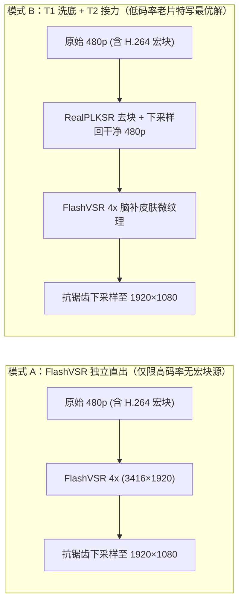

# Vela 常见问题与技术进阶解答（FAQ）

- **当前依据**：
  - [Vela 技术白皮书](technical-whitepaper.md)：VSR 三级分类体系（T1/T2/T3）与多 GPU 流式引擎架构详解。
  - [项目概览与快速开始](../README.md)：CLI 命令行参数、Docker 部署与模型权重配置说明。
  - [Spandrel PLKSR 超分器与显存后处理](../vela/models/upscaler.py)：`RealPLKSR`、`NHWC` 图融合与显存内抗锯齿缩放实现。
  - [TensorRT FP16 推理引擎](../vela/models/trt_engine.py)：跨进程锁编译与 TensorRT 异步流推理实现。

## 1. 画质与特写细节问题（T1 vs T2 进阶）

### 1.1 为什么 480p 视频用 `RealPLKSR` 超分到 1080p 后，远景和中景很清晰，但人物面部/身体大特写时皮肤细节显得“发虚”？

这是由 **存量低码率视频的物理信息丢失** 与 **T1（忠实逆退化模型）的零脑补机制** 共同决定的：

1. **中远景重在“轮廓边缘”**：在中远景镜头中，人物仅占画面的 `10%~20%`，人眼感知清晰度主要依赖五官边缘、发丝轮廓与服装线条。`RealPLKSR` 的 `17×17` 大感受野卷积核在消除 H.264 宏块并恢复锐利边缘后，1080p 观感极为通透。
2. **大特写重在“区域内部微纹理”**：在面部或身体近景大特写（Close-up）中，皮肤区域占据画面的 `40%~70%`。在 480p（如 `2 Mbps`）原片压制时，H.264 编码器为了节省码率，早已将大面积皮肤内部的微高频信号（毛孔、细微绒毛、唇纹）**100% 量化抹平为纯色块**。
3. **T1 模型的“零幻觉”铁律**：`RealPLKSR` 属于 T1 忠实修复模型，遵循“原片没有的细节绝不凭空捏造”原则。面对已被抹成纯色块的皮肤内部，它只会平滑放大并去噪，不会无中生有地画毛孔，因此在 1080p 大屏上近看特写时，会出现“五官轮廓锐利、但脸颊/肌肤内部像涂了一层柔焦”的发虚感。

### 1.2 如何快速、自动识别视频中哪些片段属于“皮肤发虚的大特写”？

在 Vela 的 GOP 切片架构下，无需逐帧运行重型检测，只需对每个 GOP 切片（默认 5 秒）**抽检中间 1~3 帧**（单帧耗时 `< 3ms`），结合以下两项指标即可精准定位所有大特写切片：

| 特写识别维度                   | 判定阈值与物理含义                                                                                                           |
| :----------------------------- | :--------------------------------------------------------------------------------------------------------------------------- |
| **判据一：人脸检测框占比**     | 使用轻量检测器（`SCRFD` / `YuNet`）：单帧最大人脸框高度占画面高度 **$\ge 30\%$**（或面积占比 **$\ge 8\%$**），判定为面部大特写 |
| **判据二：肤色占比与低频方差** | 针对非正脸的身体局部特写：统计 `YCrCb` 空间肤色像素占比 **$\ge 35\%$** 且肤色区域内拉普拉斯高频方差 **$< 25$**，判定为发虚近景特写 |

### 1.3 `FlashVSR`（T2 一步时序扩散超分）能否拯救这种特写皮肤发虚？

**完全可以，这正是 T2 模型的核心用武之地。**

- **生成先验填补空白**：`FlashVSR`（`OpenImagingLab/FlashVSR`）以阿里 **`Wan 2.1` 视频扩散大模型**为底座，通过三阶段蒸馏压缩为 **一步（One-Step）流式生成器**（包含 `LQ_proj_in` 低质投影输入层、局部约束稀疏时空注意力与 `TCDecoder` 轻量条件解码器）。它内置了海量真实人类皮肤毛孔、唇纹与眼神光的生成先验，遇到被 480p 抹平的发虚皮肤色块时，能顺着原有光影方向自动填补逼真的微纹理与肌肤光泽。
- **单步映射锁住骨相**：不同于 `Wan 2.2 V2V`（T3）通过 20~30 步高噪重绘导致人物变脸，`FlashVSR` 采用 **1-Step 单步前向映射 + 因果 KV Cache**，在补齐特写皮肤微纹理的同时，严格锁定人物原有的五官骨相与微表情。

### 1.4 `FlashVSR` 应该在特写超分到 1080p 以后工作，还是独立对 480p 工作？

**核心结论：绝不能直接把 `1080p` 原尺寸喂给 `FlashVSR`！最佳实践是「T1 去块洗底缩回 480p $\rightarrow$ FlashVSR 4x 超分至 1080p」的双级接力模式。**

1. **为什么不能在 1080p 之后直接跑 `FlashVSR`？**
   - **显存爆炸（OOM）**：`FlashVSR` 的 `LQ_proj_in` 与 `TCDecoder` 是固定 `4x` 放大结构。若直接输入 `1920×1080`，模型会试图生成 **`7680×4320`（8K）** 的潜变量与像素张量，在 24GB 显存上会立即触发 OOM。
   - **纹理尺度失配**：`FlashVSR` 的感受野与毛孔生成尺度是针对 `360p~540p` 低清输入训练的；若喂入已放大的 1080p 发虚画面，模型会误判当前已经是高分辨率平滑物体，无法激活正确尺度的毛孔生成。
2. **为什么「T1 洗底缩回 480p + T2 接力（模式 B）」优于「T2 独立直出（模式 A）」？**
   - 当 480p 原片码率极低、满脸都是 `8×8` H.264 压缩方块时，若直接让 `FlashVSR` 独立工作（模式 A），扩散模型有时会把明显的马赛克方块硬边误当成“脸上原有的皱纹或斑点”加以强化；
   - 而先通过 `RealPLKSR` 擦除所有 H.264 压缩宏块、下采样回一张**零块噪的干净 480p 底片**，再交给 `FlashVSR` 执行 `4x` 超分并缩至 `1080p`（模式 B），既完美匹配了 `FlashVSR` 的输入分辨率与显存边界，又能让它在纯净的肌肤底色上专注生成细腻毛孔与高光。

### 1.5 如何在服务器上快速验证 `FlashVSR` 对特写镜头的拯救效果？

无需渲染整部两小时长片，只需执行 **三步闭环验证法**：

1. **切片采样**：使用特写检测脚本从测试视频中截取 **2 段最典型的 3~5 秒近景特写切片（约 90~150 帧）**；
2. **三路同跑**：在同一张 GPU 上分别输出：
   - **对照组（T1）**：`Vela (RealPLKSR)` 输出的 1080p；
   - **实验组 A（T2 独立）**：原始 480p 直接喂入 `FlashVSR (4x -> 1080p)`；
   - **实验组 B（T1+T2 接力）**：`RealPLKSR` 1080p 缩回干净 480p 后喂入 `FlashVSR (4x -> 1080p)`；
3. **200% 局部放大四宫格对比**：抽取同一时间戳的特写帧，对脸颊/嘴唇/眼部区域做 200% 局部放大拼接（`原片 480p | T1 RealPLKSR | T2 FlashVSR 独立 | T1+T2 接力`），并封装为同屏对比视频直观检验皮肤微纹理与帧间稳定性。

## 2. 核心概念与技术选型问题

### 2.1 文档中提到的 `42.4 fps` 是指把视频补帧吗？为什么 60Hz 原片不需要补帧？

- **不是补帧**。Vela 报告中的 `fps` 指的是 **超分处理吞吐率（Processing Throughput）**，即 GPU 每秒钟能把多少帧画面从 480p 超分至 1080p。
- **视频补帧（VFI，如 `RIFE`）** 是指在 `24Hz` 视频相邻帧之间插值捏造新帧以变成 `60Hz`。对于本身已是 `59.94Hz` 的存量实拍片，画面运动已经极其丝滑，完全不需要补帧；相反，Vela 默认提供 `--max-fps 30` 整数倍抽稀（`59.94Hz -> 29.97Hz`），在杜绝非整数抽帧卡顿的同时将超分总帧数减半、处理速度翻倍。

### 2.2 为什么不能用游戏里的 `NVIDIA DLSS` 或 `AMD FSR 2+` 来超分存量视频？

- **物理缺失 3D 引擎数据**：`DLSS` 与 `FSR 2/3` 是 3D 游戏引擎渲染管线插件，它们必须读取游戏引擎每一帧实时生成的 **3D 几何深度缓冲（Z-Buffer）** 与 **逐像素三维物体运动矢量（Motion Vectors）**。
- **存量视频只有二维像素**：已压制的 `.mkv / .mp4` 视频文件里只剩下扁平的二维颜色像素，没有任何 3D 深度与引擎运动矢量，因此 `DLSS` 在物理原理上无法对视频文件工作。

### 2.3 开源 `RealPLKSR` 相比商业软件 `Topaz Video AI` 有什么核心优势？

1. **拒绝“塑料磨皮假脸”**：`Topaz Iris / Proteus` 在处理低码率真人面部时容易过度抹平皮肤纹理并锐化白边，产生明显的蜡像馆塑料感；2024 年下半年开源的 `RealPLKSR`（`17×17` 部分大卷积核 + `DySample` 动态点采样）能精准跨越 `8×8` H.264 宏块，保留自然胶片肤质与眼神高光。
2. **无头 Linux 多卡集群扩展**：Topaz 绑定于单机桌面 GUI；Vela + `RealPLKSR` 原生支持在无头 Linux 服务器上通过多进程 GOP 工作窃取跑满 8 张 RTX 4090 / RTX 5090，且零商业软件授权成本。
