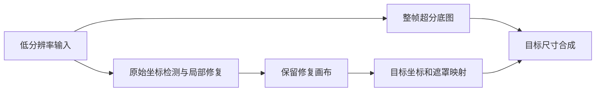
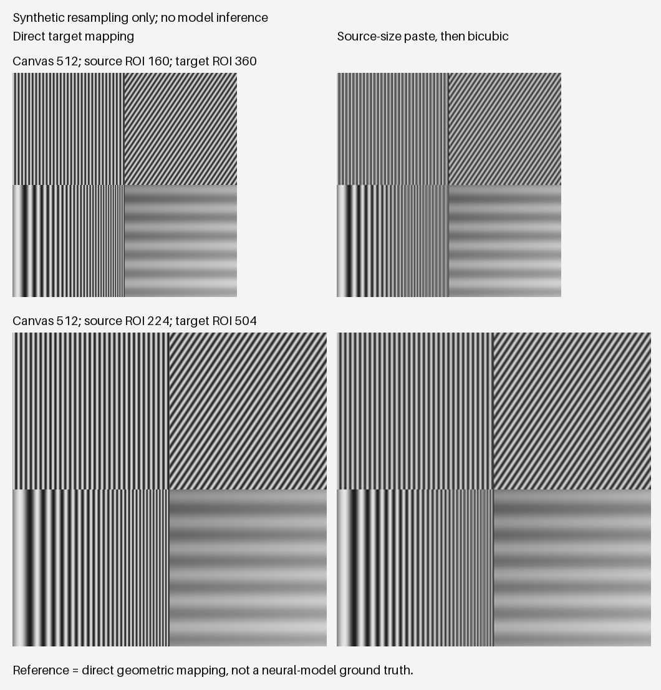

# 视频局部修复与超分顺序研究

## 1. 当前依据

- [Vela 超分与后处理](../vela/models/upscaler.py)：逐帧超分、抗锯齿目标尺寸缩放与 CAS。
- [Vela 编码、抽帧与前置滤镜](../vela/pipeline/worker.py)：影响对照公平性的输出和预处理设置。
- [Vela 默认配置](../vela/config.py)：模型、帧率上限、降噪、锐化与编码参数。
- [Jasna 裁剪相机](../../jasna/jasna/ltx/camera.py)：固定画布、上下文扩边与时序跟随裁剪。
- [Jasna 画布选择](../../jasna/jasna/ltx/plan.py)：512 与 768 画布的实际选择条件。
- [Jasna 修复区域合成](../../jasna/jasna/ltx/compose.py)：回贴尺寸、遮罩、羽化与颜色匹配。
- [Jasna 输出编码](../../jasna/jasna/media/video_encoder.py)：随输入码率变化的默认编码上限。
- [Jasna 参数校验](../../jasna/jasna/main.py)：LTX 与二次修复、降噪及帧率选项的兼容约束。
- [合成采样实验脚本](../scripts/diagnose_resampling_order.py)：无需模型和 GPU 的局部机制验证。
- [采样实验数据](assets/restoration-order/sampling-results.json)：已执行实验的完整数字、环境与限制。
- [正式研究计划](plan/2026.10.restoration-order.plan.md)：任务、依赖与验收检查点。
- [运行日志说明](runtime-log-review.md)：Jasna 与 Vela 独立运行的日志组织方式，不另设组件 benchmark。

以上源码依据按两个仓库同级检出的布局链接。实现会演进，端到端实验须记录实际代码版本、未提交补丁与权重指纹，不能只以模型名称追溯。

## 2. 研究目标与证据状态

研究低分辨率视频中，局部修复和整帧超分应如何衔接，兼顾最终结构、可用细节、时间连续性、区域边界与处理成本。压缩块清理与人为像素化区域重建属于不同问题；本文不能由其中一种任务的经验直接推断另一种的结果。

当前已经核查源码，并完成 CPU 合成纹理的重采样实验。尚未执行完整修复模型与超分模型的顺序对照，也没有目标 GPU 的本轮速度或显存结果。

**“先超分、后局部修复”是优先验证的候选路线，不是已测得的画质结论。** 回缩损失有实现和采样证据，但其影响是否大于检测变化、输入分布变化和模型生成误差，必须在端到端证据中判断。先前的顺序建议只作为待检验假说。

样本使用非露骨自然场景、普通物体或人工合成图案。修复后端必须适用于所选场景；若训练域不匹配，不能以域外结果代表它的原生质量，也不能为完成对比而把不适用素材强行送入模型。

## 3. 已确认的实现机制

### 3.1 固定修复画布与回贴尺寸

Jasna LTX 默认将跟踪区域映射到 512 像素方形画布。在启用大画布、跟踪裁剪最长边超过 640 像素且资源条件允许时，才使用 768 画布。输入视频分辨率与模型画布分辨率不是同一概念。

`canvas_to_source()` 将修复画布映射回输入帧中的裁剪尺寸。较小区域采用面积下采样，较大区域采用双三次插值；随后按遮罩、羽化和颜色匹配贴回输入尺寸的帧。

因此，当低分辨率裁剪显著小于修复画布时，先输出低清修复视频会产生一次中间回缩。后续超分可以估计新的纹理，但无法保证重新得到之前那份画布中的细节。回缩损失并不意味着被保留的生成细节就是真实细节。

### 3.2 先超分也会改变修复输入

裁剪逻辑含固定 20 像素最小边界、512 画布目标和扩边预算，不能把源视频放大视为裁剪框的简单等比例放大。先超分可能改变检测框、对象在画布中的占比、上下文和遮挡边界；模型接收的条件输入也会改变。

固定画布还意味着：从低清输入改为高清输入，主要模型开销不会简单按整帧面积比例增长。检测、合成与编解码成本会变化，并可能触发更大的模型画布，必须分别计量。

### 3.3 Vela 的实际能力

当前实现使用 Spandrel 图像超分模型，按帧批量执行，再缩放到目标尺寸并可选 CAS 锐化。FlashVSR 等时序扩散方案尚未接入当前运行后端，不能将其作为已具备的对照组。

默认前置滤镜含时空降噪，默认 CAS 强度为 0.25；默认帧率上限为 30，对高帧率源会整数倍抽帧。将这些处理置于局部修复之前或之后，改变的不只是模型顺序。

### 3.4 编码设置会造成假胜负

Vela 默认目标码率为 5 Mbps、CQ 为 20；是否写入码率上限还受低码率保留分支影响。Jasna 的默认 CQ 与之不同，而且默认最大码率取决于输入文件的码率及编码信息。

两条顺序路线的中间件分辨率、码率不同，直接沿用默认值可能使最终编码预算也不同。较清晰的输出可能只是编码损失更小。只统一 CQ 不足以排除这个因素。

## 4. 候选路线

### 4.1 路线 A：先局部修复，再整帧超分


候选优势是修复直接使用原始退化输入，超分统一处理修复区域与背景。待验证问题包括小区域回缩损失，以及后级超分是否平滑、改变或放大修复模型的纹理与误差。

### 4.2 路线 B：先整帧超分，再局部修复


候选优势是减轻修复画布回贴至低清区域的带宽损失，且修复结果不再经过后级超分。待验证问题包括检测变化、锐化或生成伪影成为修复条件、上下文变化，以及修复区域与超分背景是否协调。

### 4.3 路线 C：原始修复输入与目标尺寸合成解耦



这条路线在设计上同时保留原始修复条件与较高分辨率的修复画布，但当前两个程序的串联接口没有提供此能力。需要新增输出尺寸感知的合成接口，同步变换裁剪框、遮罩、羽化宽度、颜色匹配区域和跨窗口混合，并保证帧与时间戳对应。

路线 C 属于待评审的实现候选，不在本次文档研究中修改生产管线，也不计入已完成的实验组。

## 5. 已执行的合成重采样实验

### 5.1 方法

实验在 CPU 上产生一张 512 × 512 的已知灰度纹理画布，包含正弦条纹、斜向纹理与渐变。对相同画布比较两条几何路径：

1. **直接映射**：画布直接映射至目标区域，缩小时采用 AREA，放大时采用 bicubic。
2. **中间回缩**：画布先用 AREA 缩至源区域，再用 bicubic 放大至目标区域。

源区域边长取 96、160、224、320、480，目标边长统一为源边长的 2.25 倍。每次映射后均取整并截断至 8 位。频率指标是在去除两侧各 5% 边界后，对已知正弦频率拟合幅度。

### 5.2 结果

在每幅画布宽度包含 64 个正弦周期的测试中，中间回缩路径相对直接映射的幅度保留率如下。该比例是特定频率的对比度比例，不是整体画质评分或模型准确率。

| 源区域边长 → 目标边长 | 相对幅度保留率 |
| --------------------- | -------------- |
| 96 → 216              | 5.41%          |
| 160 → 360             | 61.27%         |
| 224 → 504             | 85.85%         |
| 320 → 720             | 92.02%         |
| 480 → 1080            | 94.78%         |

不同频率结果见[完整实验数据](assets/restoration-order/sampling-results.json)。例如 160 → 360 时，8 周期幅度约为直接映射的 100.19%，64 周期约为 61.27%；中间缩放对不同空间频率影响不同，不能解释为所有细节一律损失相同比例。插值和取整也可能造成轻微幅度增益。

96 像素中间区域的奈奎斯特上限为每幅 48 周期；64 周期已经超出该上限，因此 5.41% 同时受混叠与原频率衰减影响，不能读作仍准确保留了相同比例的原始细节。



图中左右使用相同目标尺寸、原生像素排布；浏览器整体缩放图片会影响条纹显示，应查看原始 PNG 验证。

### 5.3 可复现方式与限制

安装 `numpy`、`opencv-python` 和 `Pillow` 后，从仓库根目录执行：

```bash
python scripts/diagnose_resampling_order.py --output .tmp/restoration-order/reproduction --run-date 2026-10-28
```

原始运行环境与脚本 SHA-256 保存在实验 JSON 中。本实验没有读取私人视频、没有加载 LTX 或 RealPLKSR 权重、没有使用远程 GPU。

实验复用了同一假想修复画布；实际路线 A 与 B 会产生不同画布。bicubic 也不是 RealPLKSR，OpenCV CPU 插值不是 GPU 算子的逐位复现。报告中的 PSNR 仅描述两条几何映射输出的差异，其参照是直接映射结果，不是模型恢复真值。

**本实验验证中间回缩可能显著衰减高频，不能验证路线 B 的生成结构更正确、闪烁更少或整体画质更高。**

## 6. 端到端对照协议

### 6.1 样本与版本冻结

选择适用于修复后端的非露骨测试集，至少覆盖小、中、大区域，以及静止、平移、运动模糊、遮挡和镜头切换。准备短片烟雾测试和约 60 秒的稳定性测试。素材不足指定时长时使用真实时长，不重复填帧或宣称已达到时长目标。

有真值组从清晰非露骨视频生成受控低清、压缩和像素化退化，记录缩放核、块尺寸、区域轨迹及编码条件；无真值组仅评价可观察的一致性与观感，不计算所谓真实恢复率。

固定代码版本、模型与权重摘要、精度、种子、窗口重叠、推理后端、设备型号和软件版本。来源映射及具体连接信息保留在本地私有记录，公开报告只使用匿名样本编号和必要技术参数。

### 6.2 顺序基准与单因素对照

先比较固定 512 画布、相同模型档位的 A 与 B。基础组关闭额外降噪和锐化，保持源帧率、帧数与时间戳，验证无插帧、抽帧或错位。Vela 使用无帧率上限和零 CAS；Jasna 关闭高帧率重定时及输出锐化。

另设实用配置组再启用相同强度的后处理。允许自动 768 画布的实验也单列，记录每个跟踪段实际使用的画布和资源条件，避免把增加模型计算预算误判为单纯顺序收益。

原生检测对照反映两套完整流程。若增加共享轨迹、遮罩的控制组，需要先实现并验证相应注入接口，不能假称现有命令已支持。所有组同时记录检测覆盖、裁剪框和对象占画布比例，解释输入条件的变化。

### 6.3 编码与色彩控制

优先比较编码前帧或共同的无损中间表示，再进行相同设置的交付编码。现有 CLI 若无法导出所需表示，必须如实记录接口缺口；高码率有损编码不能标作无损。

只能进行文件串联时，两组采用相同中间编码策略，最终编码器、预设、像素格式、GOP、CQ、最大码率和缓冲区显式对齐，并核验实际输出。检查默认跟随源码率的上限是否被覆盖；不能只比较文件大小或只对齐 CQ。

色彩矩阵、范围、传递函数、色度采样和显示宽高比保持一致，帧对齐以后才计算指标。不要把缩放、颜色转换或解码器差异计入修复收益。

### 6.4 质量与资源评价

有真值组分修复区域、边界环和非修复区域报告 PSNR、SSIM，以及可用时的感知指标。报告整体与困难子集结果，避免大面积背景掩盖修复区域误差。感知指标不能单独判定生成结构真实。

时序评价使用同一运动估计与遮挡规则，比较运动补偿残差、结构跳变和边界闪烁；单张截图的锐度不能替代视频评价。多种固定种子重复测试，A/B 匿名配对观看，登记盲评偏好和失败类型。

资源评价固定单卡与并发条件，分开记录初始化、编译与预热、稳态推理、编码和总耗时，同时记录峰值显存、处理帧数和输出完整性。设备可按 RTX 4090 24 GB 这一公开规格描述，不记录具体设备身份。

## 7. 决策与验收规则

1. 先排除漏检、结构错误、明显时序不稳定和边界接缝，不能用锐度收益抵消这些失败。
2. 在统一画布和编码预算下，结合分区域指标、困难子集与视频盲评决定 A/B；性能作为独立维度报告。
3. 若不同区域尺度或运动条件存在不同优胜路线，报告适用范围，不强行总结为普遍最优。
4. 若回缩损失显著且改变修复输入又造成退化，再评审路线 C 的实现价值；实现后必须重新进入同一评价协议。
5. 只有完整模型实验和验收证据齐备，才更新推荐顺序。当前可确认的是回缩机制，完整路线选择保持待验证。

执行进度和恢复条件在[研究计划](plan/2026.10.restoration-order.plan.md)关联的变更记录中维护，本文只保留技术方法与已核验事实。
