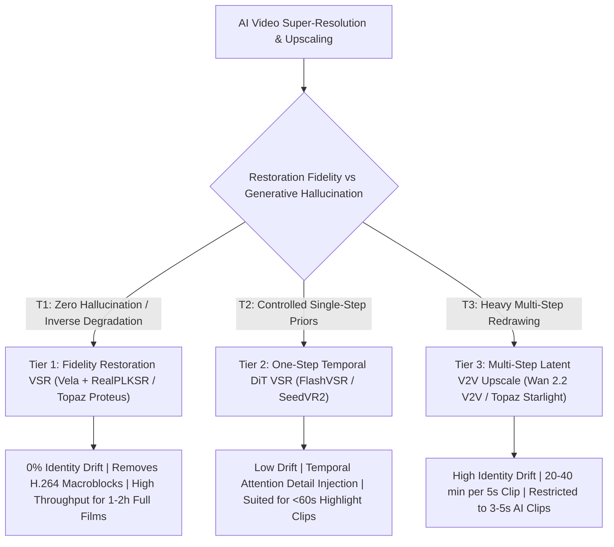
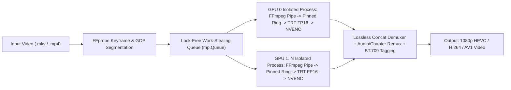
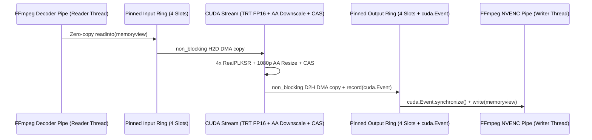

# Vela Technical Whitepaper: Multi-GPU Streaming Architecture for Real-World Video Super-Resolution

- **References**:
  - [Project Overview and Quick Start](../README.md): Core capabilities, CLI usage, and container deployment for the Vela engine.
  - [Multi-GPU Work-Stealing Scheduler](../vela/pipeline/scheduler.py): Process-isolated GOP scheduling and lossless stream remuxing implementation.
  - [Zero-Copy Async DMA Streaming Worker](../vela/pipeline/worker.py): Ring-buffered pinned-memory pipe between FFmpeg and CUDA streams.
  - [TensorRT FP16 Execution Engine](../vela/models/trt_engine.py): Automated ONNX graph export, cross-process build locking, and async TensorRT execution.
  - [Spandrel PLKSR Upscaler and VRAM Post-Processor](../vela/models/upscaler.py): `PLKConv2d` NHWC graph fusion, antialiased downscaling, and GPU Contrast Adaptive Sharpening.
  - [PLKSR Paper (arXiv:2405.11845)](https://arxiv.org/abs/2405.11845): *Partial Large Kernel CNNs for Efficient Super-Resolution* (Lee et al., 2024).
  - [Community 11-Method Video Upscaling Benchmark](https://www.reddit.com/r/StableDiffusion/comments/1xha6jy/ive_tested_11_video_upscaling_methods/): Empirical evaluation of open-source diffusion workflows, commercial desktop suites, and perceptual CNN upscalers.

## 1. Executive Summary and Taxonomy of Video Super-Resolution

In modern media engineering, the term "Video Upscaling" encompasses fundamentally different mathematical paradigms. Attempting to restore a two-hour, low-bitrate 480p live-action feature film using a multi-step generative diffusion workflow designed for three-second AI clips leads to severe identity drift and intractable compute costs.

**Vela** is purpose-built as a high-throughput, **Multi-GPU Streaming Video Super-Resolution (VSR) Engine** dedicated to **Tier 1 (Fidelity and Restoration VSR)**—restoring legacy 480p, 576p, and 720p live-action archives to crisp 1080p and 4K while preserving 100% of the subject's original facial identity and temporal stability.

### 1.1 Fundamental Dichotomy: Restoration VSR vs Generative Hallucinatory Upscaling

1. **Restoration VSR (Fidelity-Preserving Inverse Degradation)**:
   - **Mathematical Formulation**: Solves the inverse degradation problem $I_{HR} = f^{-1}(I_{LR})$. Legacy live-action recordings captured genuine physical scenes but suffered spatial downsampling, high-frequency truncation, mosquito noise, and `8×8` Discrete Cosine Transform (DCT) macroblocking during low-bitrate H.264/MPEG-4 compression.
   - **Engineering Objective**: Eliminate compression macroblocks and reconstruct attenuated physical edges **without inventing synthetic facial features**. Preserves 100% of the performer's native identity, eye catchlights, moles, and micro-expressions.
2. **Generative Upscaling (Hallucinatory Conditional Redrawing)**:
   - **Mathematical Formulation**: Treats the low-resolution video as a structural conditioning guide and samples new high-frequency details from Gaussian noise via a Diffusion Transformer (DiT).
   - **Engineering Objective**: Hallucinate synthetic skin pores, fabric weaves, and lighting on short AI-generated clips that lacked fine detail at birth, trading strict pixel fidelity and throughput for generative texture density.

### 1.2 Clarifying Throughput (`fps`) vs Video Frame Interpolation (VFI)

When evaluating video restoration pipelines, two distinct frame-rate metrics must not be conflated:

- **Processing Throughput (`fps`)**: Measures how many video frames per second the GPU cluster can upscale from 480p to 1080p (e.g., `42.4 fps` across an 8-GPU node). It reflects **compute speed** and does not alter the video's playback timing.
- **Video Frame Interpolation (VFI)**: Refers to synthesizing intermediate frames between existing frames (e.g., converting `24Hz` playback to `60Hz` via `RIFE`). High-frame-rate legacy recordings (`59.94Hz`) require spatial super-resolution rather than temporal frame synthesis; furthermore, Vela supports exact integer frame decimation (e.g., `59.94Hz -> 29.97Hz`) to halve compute load while preserving rational timebases without judder.

### 1.3 Three-Tier Industry Taxonomy (T1 / T2 / T3)

| Tier Classification and Scope                         | Representative Models, Characteristics, and Runtime Boundaries                                                                                       |
| :---------------------------------------------------- | :--------------------------------------------------------------------------------------------------------------------------------------------------- |
| **Tier 1: Fidelity Restoration VSR**                  | Open-source **`RealPLKSR`**, `ClearRealityV1`, commercial `Topaz Proteus/Iris`; **0% identity drift**, removes compression blocks, scales to 2-hour films |
| **Tier 2: One-Step Temporal Generative VSR**          | **`FlashVSR`** (Alibaba), **`SeedVR2`** (ByteDance); distilled 1-to-4 step DiT models injecting fine hair/skin texture on `<60s` highlight sequences |
| **Tier 3: Multi-Step Hallucinatory V2V Upscaling**    | **`Wan 2.2 V2V Upscale`**, `Qwen Tiled`, `Topaz Starlight`; 20-30 step latent redrawing that alters facial micro-features and takes ~40 min per short clip |

## 2. Tier 1 Deep Dive: Open-Source RealPLKSR vs Commercial Suites

For full-length live-action archives (e.g., 90 to 150 minutes, 200,000 to 500,000 frames at 480p), **Tier 1** is the only viable production paradigm. Within Tier 1, the 2024 open-source **`RealPLKSR`** architecture has surpassed both legacy GAN upscalers (`Real-ESRGAN`) and commercial desktop software (`Topaz Video AI`).

### 2.1 Architectural Breakthrough of RealPLKSR (2024)

1. **Origins and Evolution (May – October 2024)**:
   - In May 2024, Lee et al. introduced **PLKSR** (*Partial Large Kernel CNNs for Efficient Super-Resolution*, `arXiv:2405.11845`), demonstrating that applying large convolutional kernels to a partial subset of feature channels achieves transformer-grade receptive fields at a fraction of the compute cost.
   - Between May and October 2024, the open-source **`neosr`** framework (`muslll`) adapted PLKSR for real-world degradation restoration (**`RealPLKSR`**) and paired it with **`DySample`** (an ICCV 2023 content-aware dynamic point-sampling upsampler), leading to production weights such as `4xNomosWebPhoto_RealPLKSR` and `4x_RealPLKSR_dysample`.
2. **Why `17×17` Partial Large Kernels Defeat H.264 Macroblocks**:
   - Legacy CNN/GAN upscalers (`Real-ESRGAN`) stack narrow `3×3` kernels whose local receptive field is smaller than an `8×8` or `16×16` H.264 DCT macroblock. Consequently, `3×3` networks frequently mistake block boundaries for genuine object edges, amplifying compression noise into a harsh grid.
   - `RealPLKSR` utilizes **`17×17` large-kernel convolutions** across split channels. A single layer spans across entire H.264 macroblocks, allowing the network to separate periodic compression artifacts from genuine eyelashes, hair strands, and skin highlights.
   - Replacing `PixelShuffle` with **`DySample`** eliminates sub-pixel checkerboard artifacts on smooth skin tones and out-of-focus backgrounds.

### 2.2 Comparative Analysis: Vela (RealPLKSR) vs Topaz Video AI

| Evaluation Dimension                    | Open-Source `Vela + RealPLKSR` vs Commercial `Topaz Video AI (Proteus / Iris)`                                                                       |
| :-------------------------------------- | :--------------------------------------------------------------------------------------------------------------------------------------------------- |
| **Skin Texture and Facial Realism**     | **`RealPLKSR` Advantage**: `Topaz Iris/Proteus` frequently induces an artificial "plastic/waxy doll" look on low-bitrate faces; `RealPLKSR` preserves organic skin grain |
| **Macroblock & Mosquito Noise Removal** | **`RealPLKSR` Advantage**: `17×17` receptive fields and modern OTF degradation training suppress `2 Mbps` H.264 blockiness cleanly without smearing hair |
| **Headless Multi-GPU Cluster Scaling**  | **`Vela` Advantage**: Topaz is bound to single-node desktop GUIs; Vela scales linearly across 8-GPU headless Linux servers via GOP work-stealing     |
| **Inference Speed & Licensing Cost**    | **`Vela` Advantage**: TensorRT FP16 + NHWC fusion delivers superior per-GPU throughput at zero licensing cost (MIT License vs \$299+ commercial seats) |

### 2.3 Quantitative Benchmark on Legacy 480p Live-Action Footage

Evaluated on a representative 6-scene live-action benchmark (`854×480 @ 59.94fps`, `2.13 Mbps` H.264, upscaled to `1920×1080`), Tier 1 models demonstrate substantial high-frequency recovery:

| Evaluated Pipeline                              | Laplacian Sharpness Variance and Visual Assessment                                                                               |
| :---------------------------------------------- | :------------------------------------------------------------------------------------------------------------------------------- |
| **Source Baseline (480p Bicubic to 1080p)**     | Variance `63.67`; severe `8×8` H.264 macroblocking, jagged diagonal edges, and chroma banding in dark regions                    |
| **Tier 1 Primary: `RealPLKSR` (`4x -> 1080p`)** | Variance **`98.08` (`+54.0%` gain)**; complete elimination of macroblock grids, natural skin highlights, and crisp hair strands  |
| **Tier 1 Alternative: `ClearRealityV1`**        | Variance `95.21` (`+49.5%` gain); high edge acuity, though slightly less aggressive than `RealPLKSR` at suppressing mosquito noise |

## 3. Tier 2: One-Step Temporal Diffusion VSR (FlashVSR and SeedVR2)

When processing curated short-form highlight sequences (`<60 seconds`) rather than full two-hour features, **Tier 2 (One-Step / Few-Step Diffusion Transformers)** bridges the gap between strict inverse restoration (Tier 1) and heavy multi-step redrawing (Tier 3).

### 3.1 Mechanism of Distilled One-Step DiT Super-Resolution

1. **Bypassing High-Noise Destruction**: Unlike Tier 3 workflows that inject heavy Gaussian noise and run 20–30 denoising steps, Tier 2 models use adversarial or consistency distillation to map low-resolution video latents to high-resolution latents in **1 to 4 steps**.
2. **Temporal Attention**: Cross-frame attention layers aggregate sub-pixel information across adjacent frames, synthesizing fine fabric weaves and specular highlights while keeping facial geometry anchored to the source.

### 3.2 FlashVSR vs SeedVR2 Characteristics

| Tier 2 Model Architecture               | Empirical Performance and Trade-offs                                                                                                 |
| :-------------------------------------- | :----------------------------------------------------------------------------------------------------------------------------------- |
| **`SeedVR2` (ByteDance, One-Step DiT)** | Aggressive cinematic detail and skin texture reconstruction; demands high VRAM (`24GB+`) and can exhibit subtle texture shimmer in fast motion |
| **`FlashVSR` (Alibaba, Fast VSR)**      | Prioritizes temporal stability and inference speed; produces natural, flicker-free enhancement at `2-3x` the speed of `SeedVR2`      |

## 4. Tier 3: Multi-Step Latent Redrawing (Wan 2.2 V2V and Starlight)

**Tier 3** methods repurpose foundational video generation models (`Wan 2.2 14B`, `Qwen Tiled`, `LTX-2`, or commercial `Topaz Starlight`) as tiled latent re-renderers.

### 4.1 Why Tier 3 Is Unsuitable for Long-Form Live-Action Restoration

1. **Identity Drift (Facial Feature Alteration)**:
   - At denoising strengths required to synthesize new pores (`denoise >= 0.35`), the diffusion prior overwrites subtle performer traits—erasing moles, altering eye shapes, and homogenizing expressions toward synthetic training distributions.
2. **Prohibitive Compute Cost**:
   - Community benchmarks confirm that tiled `Wan 2.2` upscaling requires **20 to 40+ minutes to render a single 5-second clip** (`~0.06 fps`). Extrapolated to a 140-minute feature film, a single GPU would require **over 45 days** of continuous rendering. Tier 3 should therefore be restricted strictly to **3-to-5 second AI-generated shorts targeting 4K**.

## 5. Bypass and Legacy Technologies: DLSS, RTX VSR, and Signal Filters

A frequent architectural question is why real-time gaming upscalers (`DLSS / FSR`) or legacy `FFmpeg` filters cannot replace an offline Tier 1 engine like Vela.

### 5.1 Why NVIDIA DLSS and AMD FSR 2+ Cannot Process Video Files

- **Missing 3D Engine Buffers**: `DLSS` (Deep Learning Super Sampling) and `FSR 2/3` are **3D rendering engine plugins**, not standalone video filters. They require per-pixel **3D Depth Buffers (Z-Buffers)**, **Engine Motion Vectors**, and camera jitter matrices exported directly by a game engine's geometry pass.
- **Flat Compressed Video Pixels**: Standalone `.mkv` and `.mp4` files contain only flattened 2D YUV color planes with zero 3D geometry or engine motion vectors, making `DLSS` physically inapplicable to pre-recorded video files.

### 5.2 Driver-Level Real-Time Upscaling (`NVIDIA RTX VSR`) vs Offline Vela

- **Strict Frame-Time Budget**: Browser and player driver hooks (`RTX VSR`, `Anime4K`) must execute within `< 8–16 ms` per frame, restricting them to lightweight networks that smooth edges rather than true large-kernel restoration.
- **Playback Lock-in vs Universal Delivery**: Driver upscaling consumes `150W–300W` of desktop GPU power on every viewing and cannot benefit mobile devices, smart TVs, or NAS media servers (`Plex / Jellyfin / Emby`). Offline restoration via Vela produces a permanent, universally playable `1080p HEVC` asset.

### 5.3 Legacy Signal Filters (`FFmpeg hqdn3d + Lanczos + CAS`)

- **Role as a Zero-GPU Fallback**: Pure mathematical filtering (`hqdn3d` spatiotemporal denoise + `Lanczos` interpolation + `CAS` sharpening) improves Laplacian sharpness variance by `+18.7%` at `235–481 fps` on CPU, but cannot reconstruct lost high-frequency edges (`+54.0%` with `RealPLKSR`). It remains useful only for rapid previewing on GPU-less hosts.

## 6. Vela Multi-GPU Streaming Engine Architecture

Standard node-based AI frameworks (such as ComfyUI) decode entire video clips into uncompressed `FP32` RAM tensors before inference—consuming **`179.4 GB` of RAM for just 60 seconds of 1080p 60fps video**—or dump hundreds of thousands of intermediate `.png` files to disk. **Vela** eliminates both bottlenecks through a zero-intermediate-frame streaming architecture.

### 6.1 Multi-Process GOP Work-Stealing Topology

1. **Process-Isolated CUDA Contexts (`mp.get_context("spawn")`)**:
   - Multi-threaded Python workers suffer from Global Interpreter Lock (GIL) contention and PyTorch CUDA stream serialization when driving 8 GPUs simultaneously. Vela spawns an independent OS process per GPU (`_gpu_worker_process`), binding each worker to its dedicated `cuda:i` device.
2. **Dynamic Work-Stealing Queue & Crash-Safe Checkpointing**:
   - Long-form videos are partitioned into keyframe-aligned GOP segments (`SegmentTask`). Workers dynamically pull segments from a shared `mp.Queue`, naturally load-balancing heterogeneous clusters (e.g., mixing `RTX 5090` and `RTX 4090` GPUs).
   - Each completed segment writes an atomic `.done` marker in `.vela_work/`, enabling instant crash recovery without re-rendering finished segments.

### 6.2 Dual-Backend Neural Acceleration: TensorRT 10.16 FP16 and NHWC Fusion

Inside each GPU worker, `VelaUpscaler` maximizes TensorCore utilization through two hardware-accelerated execution paths:

1. **Primary Path — Native TensorRT FP16 Engine (`VelaTRTEngine`)**:
   - Automatically exports the `Spandrel` PyTorch model to ONNX (opset 17) and compiles an SM-specific **TensorRT FP16** serialized engine (`realplksr_sm89_b8_480x854_fp16.engine`) with persistent timing caches.
   - Uses a cross-process file lock (`_FileLock`) so parallel multi-GPU workers build the engine once and deserialize it concurrently.
   - Executes inference asynchronously via `context.execute_async_v3(stream_handle)` directly on device pointers.
2. **Fallback Path — TorchInductor `channels_last` (`NHWC`) + `PLKConv2d` Out-of-Place Patch**:
   - Standard `PLKConv2d` layers perform in-place channel slice assignment (`x[:, :self.idx] = self.conv(x[:, :self.idx])`), which breaks `torch.compile` graph capture and forces NCHW memory layouts.
   - Vela dynamically patches `PLKConv2d.forward` into an out-of-place `torch.cat` in `torch.channels_last` (`NHWC`) format, enabling TorchInductor to fuse all 28 `PLKBlock`s onto cuDNN NHWC TensorCore kernels (**`+85%` throughput increase**).
3. **In-VRAM Antialiased Downscaling and GPU CAS**:
   - The `4x` super-resolved tensor (`3416×1920`) never leaves VRAM; it is immediately downscaled to `1920×1080` via antialiased bicubic interpolation (`F.interpolate(..., antialias=True)`) and refined by a 5-tap GPU **Contrast Adaptive Sharpening (`gpu_cas_sharpen`)** kernel before uint8 quantization.

### 6.3 Zero-Copy Ring-Buffered DMA Pipeline

To prevent CPU-GPU synchronization stalls between batches, `process_segment_stream` implements a 3-stage asynchronous pipeline backed by a 4-slot pinned-memory ring buffer (`in_ring` and `out_ring`):

1. **Zero-Copy Pipe Ingestion (`_readinto_full`)**: The reader thread reads raw `rgb24` bytes from the FFmpeg decoder stdout pipe directly into a `memoryview` wrapping pre-allocated `pin_memory` tensors, eliminating intermediate Python `bytes` allocations.
2. **Asynchronous D2H DMA with `torch.cuda.Event`**: After GPU inference, the output uint8 tensor is copied asynchronously (`non_blocking=True`) into `out_ring` and tagged with a `torch.cuda.Event`. The GPU thread immediately begins the next batch while the writer thread waits on `cuda_ev.synchronize()` before flushing the `memoryview` to `hevc_nvenc`.
3. **Color Space & Frame Integrity Enforcement**: The encoder stage enforces `BT.709` color matrix, primaries, and transfer characteristics (`out_color_matrix=bt709:out_range=tv`) and validates decoded-vs-encoded frame counts before atomic segment commit.
