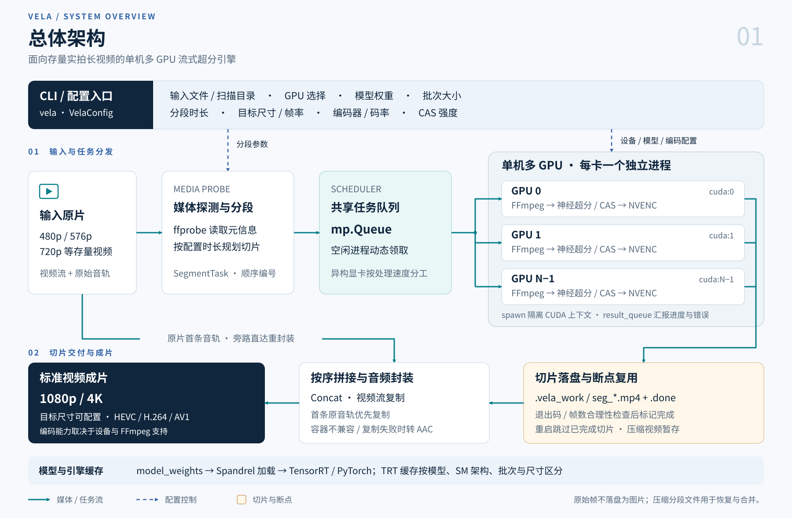
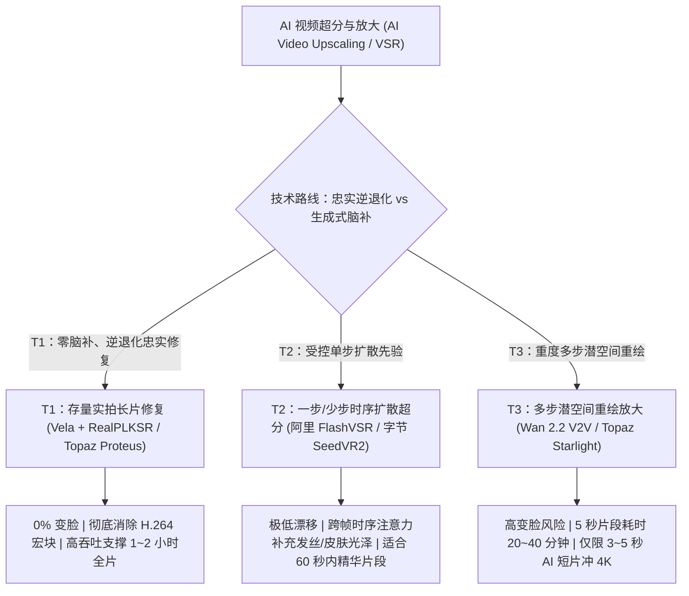
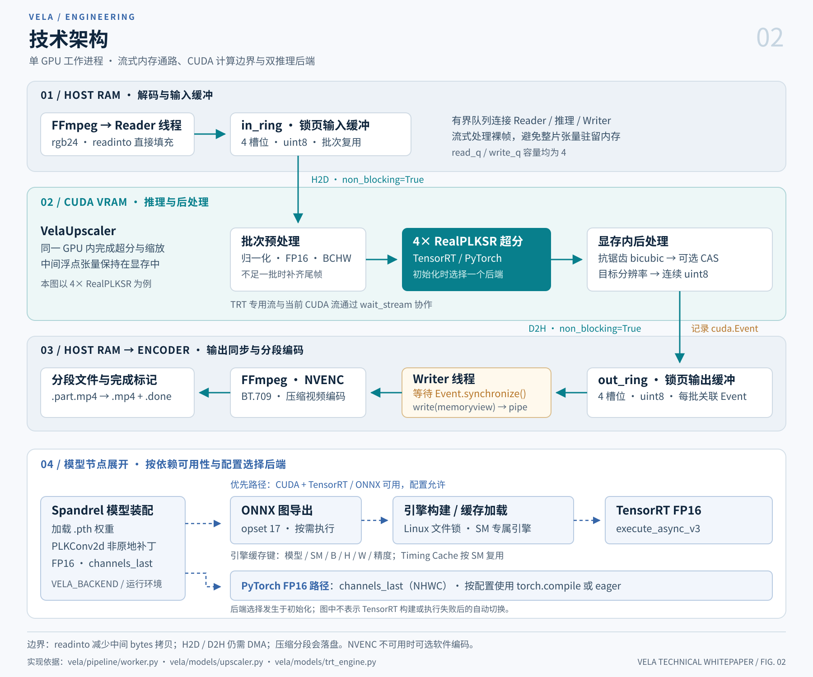
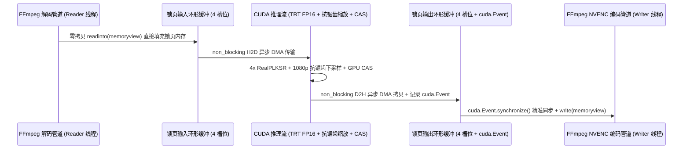

# Vela 技术白皮书：面向真实世界视频超分的多 GPU 流式引擎架构

**当前依据**

- [项目概览与快速开始](../README.md)：Vela 引擎的核心特性、CLI 命令行用法与容器化部署说明。
- [常见问题与技术进阶解答 (FAQ)](FAQ.md)：特写镜头皮肤发虚原因、特写快速识别算法与 `RealPLKSR + FlashVSR` 双级接力方案。
- [媒体探测与分段规划](../vela/pipeline/probe.py)：媒体元信息、GPU 能力探测与按时长切分任务。
- [多 GPU 动态调度器](../vela/pipeline/scheduler.py)：共享队列、多进程隔离与视频拼接、首条音轨封装实现。
- [零拷贝异步 DMA 流式工作器](../vela/pipeline/worker.py)：FFmpeg 管道与 CUDA 流之间的锁页内存环形缓冲（Pinned Memory Ring）实现。
- [TensorRT FP16 推理引擎](../vela/models/trt_engine.py)：自动 ONNX 图导出、跨进程构建文件锁与异步 TensorRT 执行器。
- [Spandrel PLKSR 超分器与显存后处理](../vela/models/upscaler.py)：`PLKConv2d` NHWC 图融合、显存内抗锯齿下采样与 GPU 自适应对比度锐化（CAS）。
- [PLKSR 论文 (arXiv:2405.11845)](https://arxiv.org/abs/2405.11845)：_Partial Large Kernel CNNs for Efficient Super-Resolution_（Lee et al., 2024）。
- [社区 11 种视频超分方法横评](https://www.reddit.com/r/StableDiffusion/comments/1xha6jy/ive_tested_11_video_upscaling_methods/)：开源扩散工作流、商业桌面软件与感知型 CNN 超分模型的实测对比。

## 1. 执行摘要与视频超分（VSR）分类体系

在现代多媒体工程中，“视频超分与放大（Video Upscaling / VSR）”涵盖了底层数学机制截然不同的多种技术范式。如果试图用面向 3 秒 AI 生成短片的多步扩散重绘工作流，去处理长达两小时的低码率 480p 存量实拍长片，不仅会导致严重的人物五官变脸（Identity Drift），还会引发指数级崩溃的算力成本。

**Vela** 是专为 **T1（忠实逆退化修复超分，Fidelity & Restoration VSR）** 打造的高吞吐、**多 GPU 流式视频超分引擎**，致力于将 480p、576p 与 720p 存量实拍视频无损升级至 1080p 与 4K，在彻底消除压缩伪影的同时，100% 锁定人物原生五官特征与跨帧时序稳定性。

_图 1 · 总体架构。上层配置驱动按时长分段与多 GPU 动态调度；压缩切片按序拼接，首条原音轨旁路进入封装。原始帧不落盘为图片，压缩分段保留用于恢复与合并。可[打开 SVG 原图](assets/vela-overall-architecture.svg)无损放大查看。_

### 1.1 核心二元划分：“VSR 存量长片忠实修复” vs “Upscale AI 脑补细节重绘”

1. **VSR 存量长片忠实修复（Restoration VSR，逆退化还原）**：
   - **数学本质**：求解图像退化逆问题 $I_{HR} = f^{-1}(I_{LR})$。存量实拍影视在当年拍摄时本具备真实的物理场景与面部细节，但在早期低码率 H.264/MPEG-4 压制（如 480p `2.1 Mbps`）过程中遭受了空间降采样模糊、高频截断、蚊噪（Mosquito Noise）以及 `8×8` 离散余弦变换（DCT）宏块伪影。
   - **工程目标**：**“擦掉马赛克宏块、擦亮镜头”**。仅消除压缩块并恢复被削弱的物理边缘，**严禁凭空捏造原片不存在的五官特征**，实现 **0% 变脸（100% 保留演员原生眼神高光、泪痣与微表情）**。
2. **Upscale AI 脑补细节超分（Generative Upscaling，生成式条件重绘）**：
   - **数学本质**：将低清视频作为结构条件引导（Conditioning Guide），调用视频扩散变换器（DiT）从高斯噪声中重新采样并合成新的高频细节。
   - **工程目标**：**“照着低清底片把细节重新画出来”**。专门针对先天缺乏真实毛孔、织物经纬与发丝细节的 AI 生成短片，以牺牲像素忠实度与推理速度为代价，换取生成式纹理密度。

### 1.2 概念纠偏：“超分处理吞吐率（fps）”与“视频补帧（VFI）”的区别

在评估视频修复管线时，必须严格区分以下两个同样以帧率表示、但物理意义完全不同的指标：

- **超分处理吞吐率（Processing Throughput，单位 `fps`）**：指 GPU 集群**每秒钟能将多少帧画面从 480p 超分至 1080p**（例如 8 卡节点达到 `42.4 fps`）。它衡量的是**算力渲染速度**，不会改变输出视频本身的播放快慢。
- **视频补帧（Video Frame Interpolation, VFI）**：指在原本只有 `24Hz / 30Hz` 的相邻帧之间**凭空插值合成中间帧**（如使用 `RIFE` 升格至 `60Hz`）。对于本身已是高帧率（`59.94Hz`）的存量实拍视频，完全不需要做时序补帧；相反，Vela 支持精准的**整数倍帧率抽稀（Integer Frame Decimation，如 `59.94Hz -> 29.97Hz`）**，在严格保持有理数时基（Rational Timebase）、杜绝抽帧卡顿的前提下将算力开销直接减半。

### 1.3 行业三级分类体系（T1 / T2 / T3）全景对照

| 梯队分级与适用范畴                              | 代表技术方案、核心特征与时长边界                                                                                                                      |
| :---------------------------------------------- | :---------------------------------------------------------------------------------------------------------------------------------------------------- |
| **T1：存量长片忠实修复（Restoration VSR）**     | 开源 **`RealPLKSR`**、`ClearRealityV1`、商业 `Topaz Proteus/Iris`；**0% 变脸**，专注消除压缩块与还原真实边缘，支撑 **1~2 小时存量实拍长片**           |
| **T2：一步时序生成式超分（One-Step DiT VSR）**  | 阿里 **`FlashVSR`**、字节 **`SeedVR2`**；经蒸馏的 1~4 步时序扩散模型，在锁定五官结构的前提下适度补充发丝与微纹理，适合 **60 秒以内高能精华片段**      |
| **T3：多步潜空间重绘放大（Hallucinatory V2V）** | **`Wan 2.2 V2V Upscale`**、`Qwen Tiled`、`Topaz Starlight`；20~30 步分块潜空间重绘，极易篡改面部微特征且单短片耗时约 40 分钟，仅限 **3~5 秒 AI 短片** |

## 2. T1 深度剖析：开源 RealPLKSR 对决商业软件 Topaz Video AI

面对 90 至 150 分钟（20 万至 50 万帧）的 480p 存量实拍长片，**T1** 是唯一具备工业可行性的技术范式。在 T1 赛道中，2024 年下半年成熟的开源 **`RealPLKSR`** 架构已在肤质自然度与多卡集群扩展能力上全面超越传统 GAN 模型（`Real-ESRGAN`）与商业桌面标杆（`Topaz Video AI`）。

### 2.1 2024 开源破局者：`RealPLKSR + DySample` 架构原理

1. **学术起源与开源演进（2024 年 5 月 ~ 10 月）**：
   - **2024 年 5 月**：Lee 等人发表 **PLKSR** 论文（_Partial Large Kernel CNNs for Efficient Super-Resolution_, `arXiv:2405.11845`），证明无需引入高开销的 Transformer 自注意力机制，仅对部分特征通道施加超大卷积核即可获得媲美 Transformer 的大感受野。
   - **2024 年 5 月 ~ 10 月**：开源框架 **`neosr`**（`muslll`）将 PLKSR 拓展至真实世界退化修复领域（**`RealPLKSR`**），并融合 ICCV 2023 提出的动态点采样上采样器 **`DySample`**，相继孵化出 `4xNomosWebPhoto_RealPLKSR` 与 `4x_RealPLKSR_dysample` 等工业级开源权重。
2. **为什么 `17×17` 部分大卷积核能精准克制 H.264 宏块？**
   - 早期 CNN/GAN 超分器（如 `Real-ESRGAN`）堆叠狭窄的 `3×3` 卷积核，其局部感受野比 H.264 的 `8×8` 或 `16×16` DCT 压缩宏块还要小，极易将宏块的方块边界误判为真实物体边缘并加以锐化，导致画面出现刺眼的网格噪点。
   - `RealPLKSR` 在分流通道上直接采用 **`17×17` 超大卷积核**，单层感受野即可完整跨越整个 H.264 压缩宏块，使网络能够从宏观上下文直接甄别“周期性压缩伪影”与“真实眼睫毛/发丝/高光”。
   - 用 **`DySample`**（内容感知动态坐标点采样）替代传统的 `PixelShuffle`（子像素卷积），彻底根除了平滑肌肤与暗部散景上的亚像素棋盘格伪影（Checkerboard Artifacts）。

### 2.2 核心能力对决：`Vela (RealPLKSR)` vs `Topaz Video AI`

| 评估维度                    | 开源 `Vela + RealPLKSR` 对决商业桌面软件 `Topaz Video AI (Proteus / Iris)`                                                                         |
| :-------------------------- | :------------------------------------------------------------------------------------------------------------------------------------------------- |
| **真人肤质与五官自然度**    | **`RealPLKSR` 胜出**：`Topaz Iris/Proteus` 处理低码率人脸时极易产生“蜡像馆塑料磨皮感（Plastic/Waxy Look）”与白边过冲；`RealPLKSR` 保留真实胶片肤质 |
| **去宏块与抗蚊噪能力**      | **`RealPLKSR` 胜出**：依靠 `17×17` 大感受野与现代动态退化训练，对 `2 Mbps` 低码率 H.264 块效应的抚平比 `Topaz Proteus` 更干净且不涂抹发丝细节      |
| **无头 Linux 多卡集群扩展** | **`Vela` 完胜**：Topaz 受限于 Windows/macOS 单机桌面 GUI；Vela 原生支持无头 Linux 服务器，通过 GOP 工作窃取在 8 卡集群上实现线性加速               |
| **推理吞吐率与许可证成本**  | **`Vela` 完胜**：TensorRT FP16 + NHWC 算子融合带来极高单卡吞吐，且采用 MIT 开源协议零授权成本（对比 Topaz 299 美元以上的商业授权）                 |

### 2.3 低码率 480p 存量实拍视频量化实测基准

在包含 6 个复杂实拍场景的基准测试集（源视频为 `854×480 @ 59.94fps`，`2.13 Mbps` H.264，超分至 `1920×1080`）上，T1 模型的高频细节恢复表现如下：

| 评测管线与模型                                 | 拉普拉斯高频清晰度方差与主观画质评估                                                                |
| :--------------------------------------------- | :-------------------------------------------------------------------------------------------------- |
| **源视频基准（480p 双三次插值至 1080p）**      | 清晰度方差 `63.67`；存在明显的 `8×8` H.264 宏块网格、斜线锯齿与暗部色带                             |
| **T1 主力：`RealPLKSR`（`4x -> 1080p`）**      | 清晰度方差 **`98.08`（提升 `+54.0%`）**；彻底消除宏块网格，人物皮肤高光通透，发丝与睫毛边缘锐利自然 |
| **T1 备选：`ClearRealityV1`（`4x -> 1080p`）** | 清晰度方差 `95.21`（提升 `+49.5%`）；轮廓锐度极高，但对暗部低码率压缩蚊噪的抑制略逊于 `RealPLKSR`   |

## 3. T2：一步/少步时序扩散超分（FlashVSR 与 SeedVR2）

当处理对象从“两小时全片”聚焦到 **60 秒以内的精选高能片段** 时，**T2（一步/少步时序扩散变换器）** 在 T1 的几何忠实度与 T3 的纹理生成力之间提供了理想的折中点。

### 3.1 蒸馏一步扩散超分（One-Step DiT）机制

1. **跨越重度加噪破坏阶段**：不同于 T3 先注入大量高斯噪声再做 20~30 步去噪，T2 模型利用对抗蒸馏（Adversarial Distillation）或一致性蒸馏，仅用 **1 至 4 步** 即可将低清视频潜变量直接映射为高清潜变量，从而保住人物原有五官结构。
2. **跨帧时序注意力（Temporal Attention）**：通过聚合相邻帧的亚像素位移信息，在保持跨帧平滑的同时合成逼真的织物纹理与发丝光泽。

### 3.2 `FlashVSR` 与 `SeedVR2` 特性对照

| T2 模型架构                          | 实测表现与工程权衡                                                                                                     |
| :----------------------------------- | :--------------------------------------------------------------------------------------------------------------------- |
| **`SeedVR2`（字节跳动，一步 DiT）**  | 电影级光影与皮肤微纹理重构力度极强；但显存开销庞大（需 `24GB+`），且在剧烈运动背景下偶发动态纹理微闪                   |
| **`FlashVSR`（阿里巴巴，高速 VSR）** | 优先保障时序稳定性与推理速度；细节增强克制自然，几乎零闪烁，推理速度比 `SeedVR2` 快 `2~3 倍`，更契合实拍短片段二次精修 |

## 4. T3：多步潜空间重绘脑补（Wan 2.2 V2V 与 Topaz Starlight）

**T3** 路线将 14B 级视频生成底座（如 `Wan 2.2`、`Qwen Tiled`、`LTX-2` 或商业模型 `Topaz Starlight`）改造为分块潜空间重绘器（Tiled Latent Re-renderer）。

### 4.1 为什么 T3 严禁用于存量实拍长片修复

1. **身份漂移与五官篡改（Identity Drift）**：
   - 当去噪强度达到足以生成新毛孔的阈值（`denoise >= 0.35`）时，视频大模型的生成先验会覆盖原片演员的细微面部特征——抹除泪痣、改变眼型与嘴角弧度，将其同质化为训练集的平均模特脸。
2. **算力与耗时的指数级倒挂**：
   - 社区基准实测表明，分块 `Wan 2.2` 超分渲染短短 5 秒视频即需耗时 **20 至 40 分钟以上**（约 `0.06 fps`）。若折算至 140 分钟的长片，单卡需连续渲染 **超过 45 天**。因此 T3 仅限于 **3~5 秒原生 AI 生成短片冲刺 4K**。

## 5. 旁路与传统技术：DLSS 边界、RTX 实时超分与信号滤镜

工程实践中常被问及：为何游戏领域的实时超分神技（`DLSS / FSR`）、显卡驱动实时超分（`RTX VSR`）或传统 `FFmpeg` 滤镜不能替代 Vela？

### 5.1 为什么 `NVIDIA DLSS` 与 `AMD FSR 2+` 无法处理视频文件

- **物理缺失 3D 引擎缓冲区**：`DLSS` 与 `FSR 2/3` 是 **3D 游戏渲染引擎内部插件**，而非独立视频滤镜。它们必须依赖游戏引擎在几何渲染阶段实时导出的 **3D 深度缓冲（Z-Buffer）**、**逐像素三维物体运动矢量（Engine Motion Vectors）** 与摄像机抖动矩阵。
- **存量视频仅有二维扁平像素**：封装好的 `.mkv` 与 `.mp4` 视频文件仅包含经过有损压缩的二维 YUV 色彩平面，完全不存在 3D 几何深度与引擎运动矢量，因此 `DLSS` 在物理原理上无法对视频文件生效。

### 5.2 驱动级实时超分（`NVIDIA RTX VSR`）与离线 Vela 的差异

- **严苛的帧耗时预算**：播放器与浏览器驱动钩子（`RTX VSR`、`Anime4K`）必须在单帧 `< 8~16 ms` 内完成计算，因此只能运行极度简化的轻量网络，面对低码率 H.264 宏块时仅能做简单平滑锐化，无法实现 `RealPLKSR` 级别的大感受野逆退化重构。
- **播放端锁死 vs 全平台通用交付**：驱动级实时超分每次观看都会带来 `150W~300W` 的桌面显卡功耗，且无法惠及手机、平板、Apple TV 或家庭 NAS 媒体库（`Plex / Jellyfin / Emby`）。通过 Vela 离线渲染一次，即可产出全终端永久通用的 `1080p HEVC` 标准资产。

### 5.3 传统信号滤镜（`FFmpeg hqdn3d + Lanczos + CAS`）

- **无显卡环境的极速兜底**：纯数学滤波（`hqdn3d` 时空降噪 + `Lanczos` 插值 + `CAS` 锐化）可在纯 CPU 上跑出 `235~481 fps` 并提升 `+18.7%` 的边缘对比度，但无法重建丢失的高频发丝（`RealPLKSR` 提升 `+54.0%`），仅适合作为无 GPU 主机上的快速预览旁路。

## 6. Vela 多 GPU 流式超分引擎架构详解

将整段视频一次性解码为未压缩的 `FP32` 内存张量时，**仅 60 秒的 1080p 60fps RGB 视频就需要约 `89.6 GB`（`83.4 GiB`）内存**；采用中间帧文件的流程则会在磁盘上读写大量临时图片。**Vela** 通过有界环形缓冲与多进程流式处理控制裸帧内存占用，不生成中间帧图片；编码后的压缩分段仍会写入 `.vela_work/`，用于恢复与最终拼接。

_图 2 · 技术架构。裸帧沿 Host RAM → CUDA VRAM → Host RAM 流转，Writer 等待 CUDA Event 后送入编码器；下方展开 TensorRT 与 PyTorch 的初始化选择、模型装配及缓存关系。可[打开 SVG 原图](assets/vela-technical-architecture.svg)无损放大查看。_

### 6.1 多进程隔离的分段动态调度拓扑

总体拓扑见图 1。当前实现由单机主进程按配置时长规划 `SegmentTask`，通过共享 `multiprocessing.Queue` 分发；未进行关键帧扫描或 GOP 边界对齐，也不将队列实现描述为无锁。

1. **进程级隔离的 CUDA 上下文（`mp.get_context("spawn")`）**：
   - 多线程共享 Python 进程在同时驱动 8 张 GPU 时会遭遇严重的全局解释器锁（GIL）争用与 CUDA 流序列化阻塞。Vela 为每张 GPU 派生独立的操作系统子进程（`_gpu_worker_process`），将每个工作进程独占绑定至专属 `cuda:i` 设备。
2. **动态领取任务与分段断点复用**：
   - 长视频按配置时长被切分为独立任务。各 GPU 进程从共享 `mp.Queue` 中动态领取切片，使同机异构显卡（如 `RTX 5090 + RTX 4090` 混插）按处理速度分担工作。
   - 每个切片通过 FFmpeg 退出码与处理帧数合理性检查后，以 `.part.mp4` 替换正式分段文件，再写入 `.done` 标记。重启时，工作器检查分段文件与完成标记是否存在、文件大小是否大于 `1024` 字节，满足条件即跳过；`.done` 本身不是原子写入。
3. **按序合并与音频封装**：
   - 主进程按切片编号执行 Concat，以 `-c:v copy` 拼接编码视频；仅映射原片首条音轨，优先复制，封装不兼容或复制失败时转为 `AAC 192k`。当前代码未显式映射字幕，也未建立完整章节保留契约。

### 6.2 双后端神经网络加速：TensorRT 10.16 FP16 与 NHWC 算子融合

在每个 GPU 工作进程内部，`VelaUpscaler` 按 `VELA_BACKEND` 配置、CUDA 与依赖可用性选择 TensorRT 或 PyTorch 路径（图 2 下半部）；该选择发生在初始化时，当前实现不提供 TensorRT 构建或执行失败后的自动切换：

1. **主后端 —— 原生 TensorRT FP16 引擎（`VelaTRTEngine`）**：
   - 自动将 `Spandrel` 加载的 PyTorch 模型导出为 ONNX（opset 17），并针对当前显卡 SM 架构编译持久化的 **TensorRT FP16** 序列化引擎（如 `realplksr_sm89_b8_480x854_fp16.engine`）与 Timing Cache。
   - 在 Linux / 容器环境使用跨进程文件锁（`_FileLock`），避免同一缓存键的并发构建；缓存按模型、SM 架构、批次大小、输入尺寸与精度区分，命中后直接反序列化加载。不同 SM 架构分别构建引擎。
   - 通过 `context.execute_async_v3(stream_handle)` 直接绑定显存张量指针异步执行，实现零额外显存拷贝。
2. **后备后端 —— TorchInductor `channels_last` (`NHWC`) + `PLKConv2d` 非原地融合补丁**：
   - 标准 `PLKConv2d` 层使用原地切片赋值（`x[:, :self.idx] = self.conv(x[:, :self.idx])`），这会打断 `torch.compile` 图捕获并强制退回 NCHW 内存布局。
   - Vela 在运行时将 `PLKConv2d.forward` 动态热替换为基于 `torch.channels_last`（`NHWC`）的非原地 `torch.cat`，使 TorchInductor 能够将全部 28 个 `PLKBlock` 完整融合至 cuDNN NHWC TensorCore 路径（**单卡吞吐率提升 `+85%`**）。
3. **显存内抗锯齿下采样与 GPU CAS 锐化**：
   - 经 `4x` 超分放大后的张量（`3416×1920`）全程驻留显存，直接在 VRAM 内通过抗锯齿双三次插值（`F.interpolate(..., antialias=True)`）下采样至 `1920×1080`，随后经纯 PyTorch 实现的 5 抽头 GPU **自适应对比度锐化（`gpu_cas_sharpen`）** 增强微边缘，最后量化为连续 `uint8` 字节流。

### 6.3 锁页内存环形缓冲（Pinned Ring）与异步 DMA 流水线

为减少批次之间的 CPU-GPU 同步等待，`process_segment_stream` 构建了基于 4 槽位锁页内存环形缓冲（`in_ring` 与 `out_ring`）的三级流水线。这里的“零拷贝读取”仅指减少 Python 中间 `bytes` 对象；H2D 与 D2H 仍执行 DMA 数据传输，不表示端到端零拷贝或 GPUDirect：

1. **零拷贝管道读取（`_readinto_full`）**：读取线程直接通过 `memoryview` 将 FFmpeg 解码器输出的裸 `rgb24` 字节流写入预分配的 `pin_memory` 张量槽位，消除了 Python `bytes` 中间对象的内存分配与拷贝。
2. **基于 `torch.cuda.Event` 的异步 D2H DMA**：GPU 完成当前批次超分后，以 `non_blocking=True` 异步拷贝至 `out_ring` 并打上 `cuda.Event` 硬件事件戳，主推理线程立即无缝处理下一批次；写入线程仅在对应的 `cuda_ev.synchronize()` 触发后将 `memoryview` 刷入 `hevc_nvenc`。
3. **BT.709 色彩标记与处理帧数合理性检查**：编码阶段设置 `BT.709` 色彩矩阵与传输特性（`out_color_matrix=bt709:out_range=tv`）。分段完成时检查解码器、编码器退出码，并将处理帧数与时长推算值比较，容差为 `max(4 帧, 预计帧数的 5%)`；当前检查不包含重新探测编码帧数或逐帧内容验证。
